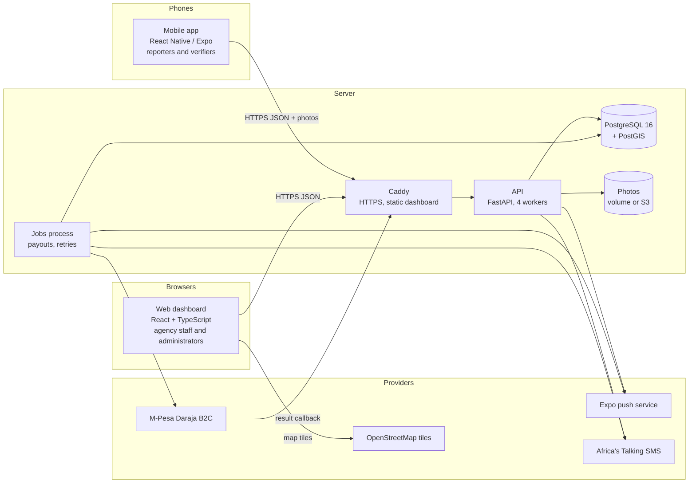

# Architecture

TraceHealth has three applications and one database:

In development the same pieces run without Caddy: the API on port 8000 (with
the jobs running inside it), the dashboard dev server on 5173, the Expo dev
server for the phone, and PostgreSQL in Docker.

## Backend (`backend/`)

Layered so each layer has one job:

| Layer | Folder | Responsibility |
|---|---|---|
| Routes | `app/api/routes/` | HTTP: parse input, check the role, call a service, shape the response. No business rules. |
| Schemas | `app/schemas/` | Pydantic request/response models; input validation with plain-language messages. |
| Services | `app/services/` | Business rules: submission, verification, clinic import, linkage engine, payouts, notifications, audit. |
| Models | `app/models/` | SQLAlchemy 2.0 tables, one file per entity. |
| Integrations | `app/integrations/` | Outside providers behind small interfaces, each with a mock: `payments/` (mock, M-Pesa Daraja), `push/` (mock, Expo), `sms/` (mock, Africa's Talking). |
| Storage | `app/storage/` | Photo storage: local disk or S3-compatible. |
| Core | `app/core/` | Settings, security (Argon2, JWT), dependencies (RBAC), phone normalisation, background jobs. |
| Migrations | `alembic/versions/` | 0001 schema + triggers + default settings; 0002 verification/notifications; 0003 payout attempts, import summary, linkage coverage. |

**Rules live in two places on purpose.** The API checks every rule and returns
a clear message; the database enforces the critical ones again with
constraints and triggers (no self-verification, one final decision, one
payout per report, payout only for verified reports with consent, linkages
only for verified reports, append-only audit log). A bug in one layer cannot
silently break the rules.

**Synchronous SQLAlchemy** (D17): FastAPI runs each request in a thread pool.
Each worker keeps up to 15 database connections; 4 workers stay well under
PostgreSQL's 100.

**Work after the response.** Push and SMS sending and payout processing run as
FastAPI background tasks after the response is sent, so the phone is not kept
waiting. Anything missed (server restart) is picked up by the periodic jobs:
send due payouts with backoff, expire M-Pesa requests with no result, and
retry undelivered notifications. In production these jobs run in one separate
process (`scripts/run_jobs.py`, D46).

### Main flows

| Flow | Path through the code |
|---|---|
| Submit report (B.3) | `POST /reports` → `report_service.submit_report` (photo cleaned, zone assigned, verifiers notified) → background push |
| Offline sync | phone SQLite queue → `POST /reports/{client_report_id}/sync` (idempotent) |
| Verify (B.4) | `POST /reports/{id}/verify` → `verification_service.decide` (row lock, audit, PENDING payout) → `linkage_engine.compute_safely([id])` → background payout + notifications |
| Clinic import (B.5) | `POST /clinic-data/import` → `clinic_import_service.import_csv` (all-or-nothing) → `linkage_engine.compute_safely()` |
| Dashboard (FR 4) | `/dashboard/*` read-only aggregates of VERIFIED reports; small counts hidden |
| Payout (B.6) | `payout_service.process_payouts` → adapter → COMPLETED / ACCEPTED (wait for M-Pesa callback) / FAILED / RETRY / UNKNOWN |

## Web dashboard (`dashboard/`)

Vite + React 19 + TypeScript, TanStack Query for server data, React Router 7,
Tailwind CSS 4, react-leaflet + leaflet.heat for maps, Recharts for charts,
i18next for English/Kiswahili.

| Folder | Contents |
|---|---|
| `src/api/` | `client.ts` (tokens, refresh on 401, typed errors), `endpoints.ts` (one function per endpoint) |
| `src/auth/` | sign-in state; non-dashboard roles are turned away and their session revoked |
| `src/components/` | layout, filters, dialog, pills, empty/error/loading states, report photo |
| `src/features/` | one folder per page: overview, map, trends, reports, clinic-import, users, audit, payouts, settings |
| `src/lib/` | formatting and colour helpers |
| `src/i18n/` | `en.json`, `sw.json` (same keys, checked by a test) |
| `tests/` | Vitest + Testing Library component tests |
| `e2e/` | Playwright tests in Chrome and Edge against the real API |

Pages are loaded on demand, so the map and chart libraries are only downloaded
when those pages open. Administration pages are hidden for agency staff and
also refused by the API.

## Mobile app (`mobile/`)

Expo SDK 58 (React Native 0.88) with Expo Router; screens live in
`mobile/src/app/` (D29).

| Folder | Contents |
|---|---|
| `src/app/` | screens: welcome, login, register, `(tabs)` (home, reports, review, inbox, account), new-report wizard, report and review detail |
| `src/offline/` | SQLite queue and sync engine (offline-first, D23) |
| `src/api/` | API client with token refresh and timeouts |
| `src/auth/` | secure token store and auth context |
| `src/notifications/` | push registration and tap routing |
| `src/review/` | verifier decision logic |
| `src/components/` | shared UI: buttons, fields, category picker, decision panel, payout settings |
| `src/i18n/` | English and Kiswahili |

## Data model

The full entity list is in the plan and in `backend/app/models/`. The UML class
diagram as built is in [`uml/class-diagram.md`](uml/class-diagram.md); the
sequence diagrams for the SRS Appendix B flows are in [`uml/`](uml/).
