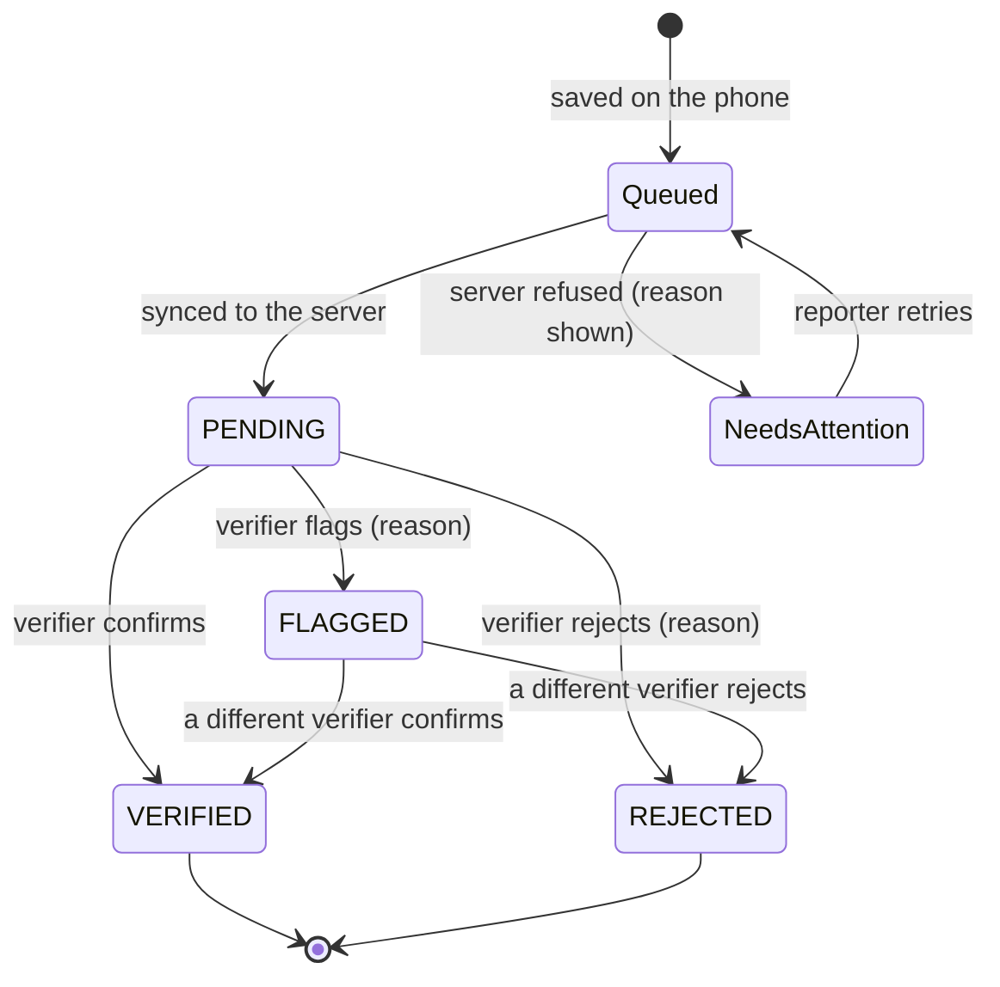
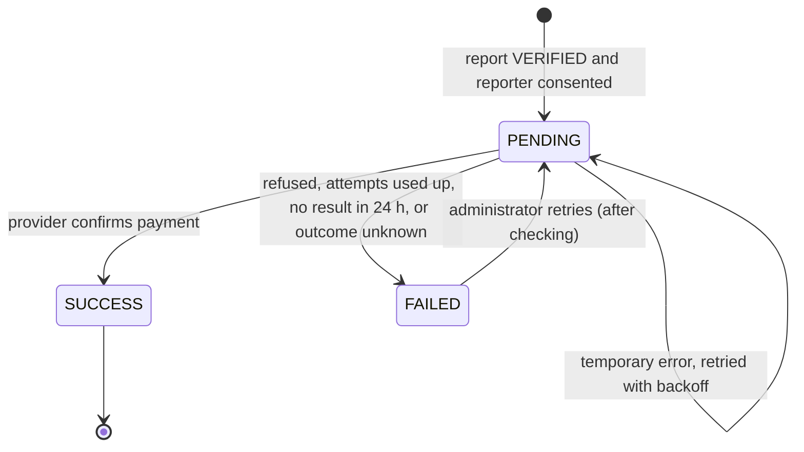

# State machines

## Pollution report

Queued and NeedsAttention exist only on the phone. VERIFIED and REJECTED are
final (database trigger). Only VERIFIED reports appear on the dashboard, get
health linkages and earn a reward.

## Payout

